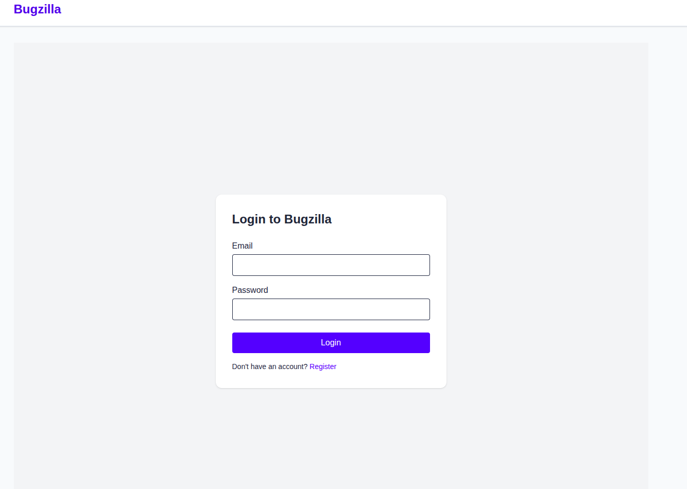
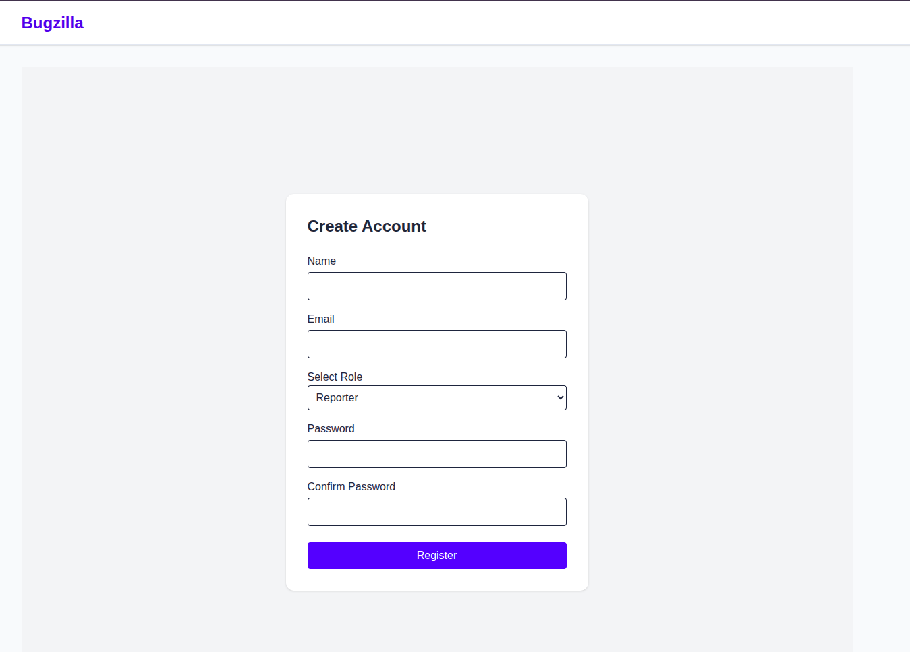
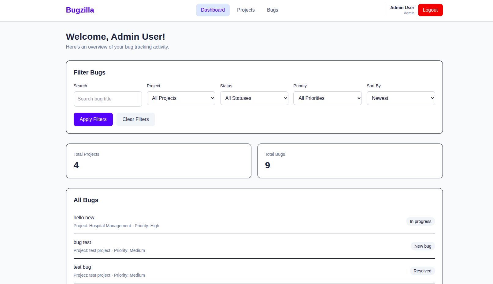
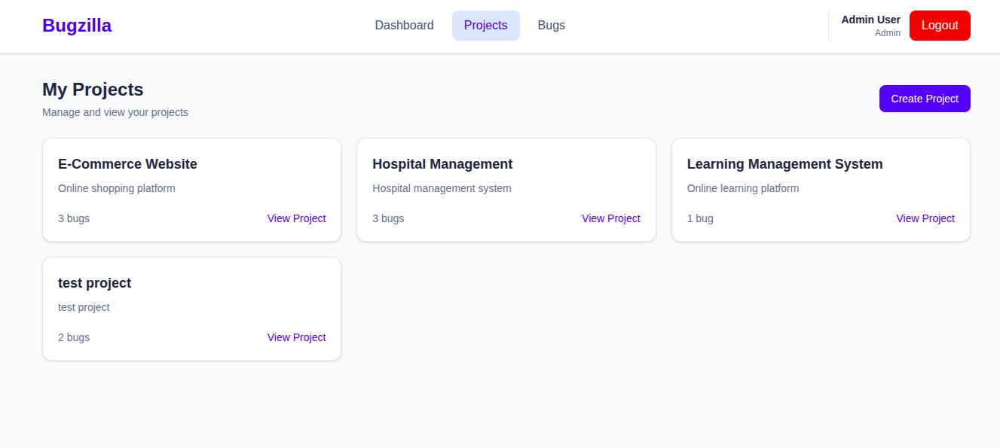
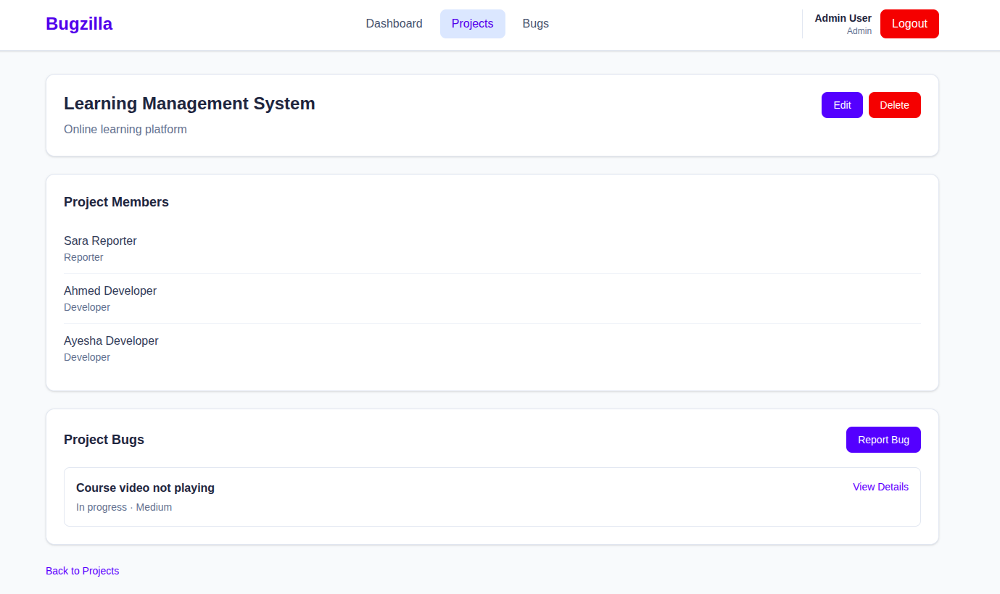
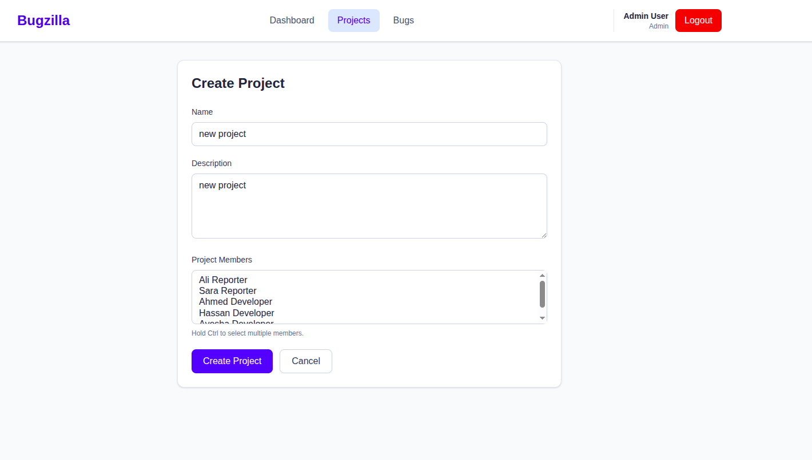
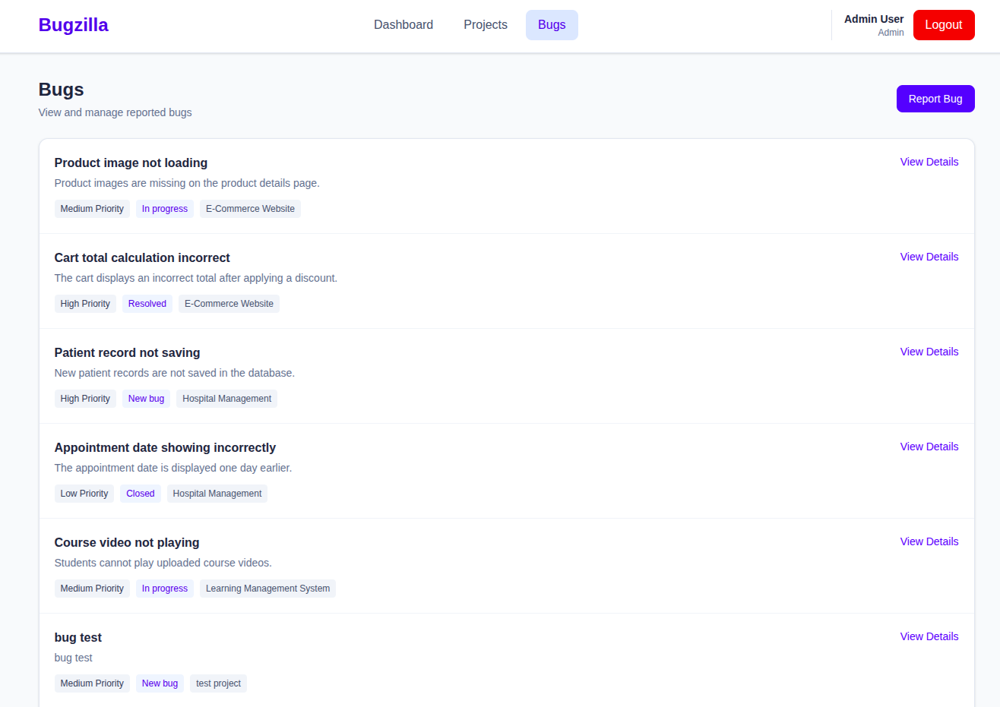
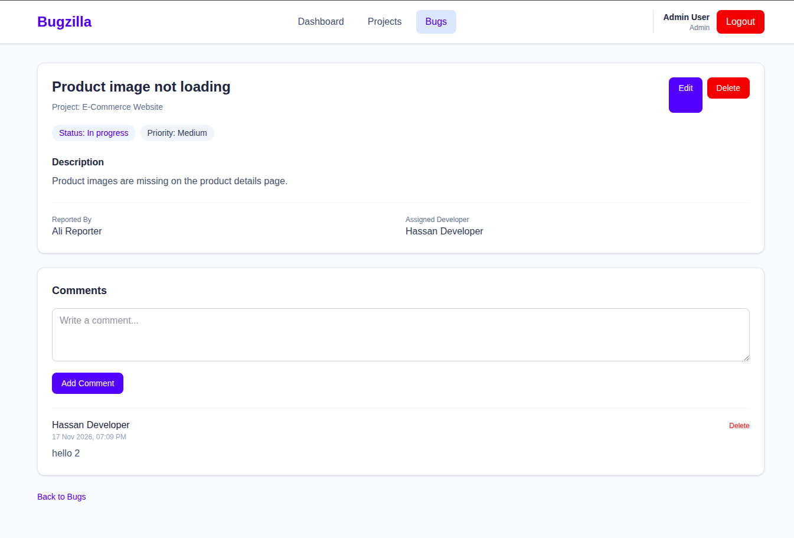
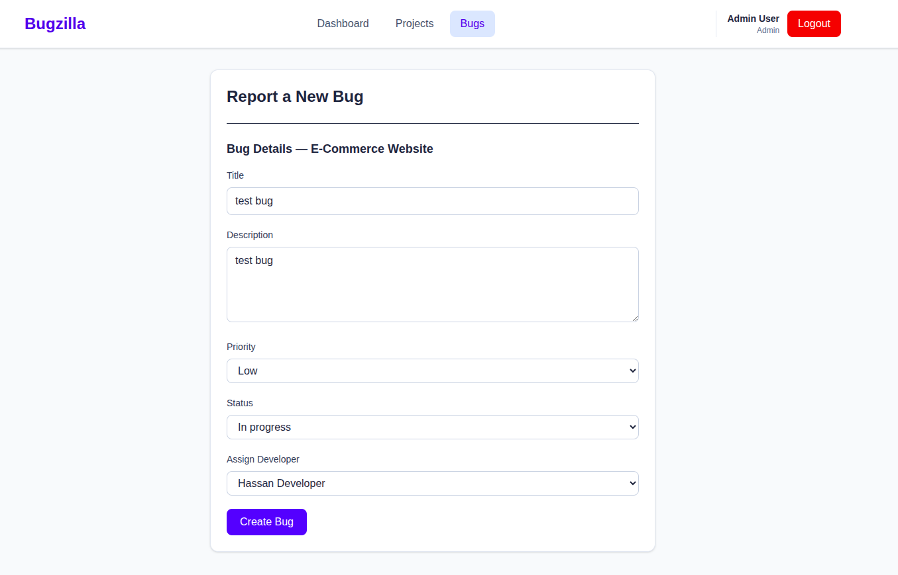

# Bugzilla – Bug Tracking System

## 1. Project Overview

Bugzilla is a web-based Bug Tracking System developed using Ruby on Rails. It allows users to report, assign, track, and manage bugs within different projects.

The application provides role-based access for Admins, Reporters, and Developers.

## 2. Technologies Used

- **Backend:** Ruby on Rails 7.2.4
- **Programming Language:** Ruby 3.1.2
- **Database:** PostgreSQL
- **Frontend:** HTML, ERB, Tailwind CSS
- **Authentication:** Rails sessions and bcrypt
- **Dependency Management:** Bundler

## 3. User Roles

### Admin

- Create, update, and delete projects.
- Manage project members.
- View and manage all bugs.

### Reporter

- View assigned projects.
- Report new bugs.
- Assign developers to reported bugs.
- Review resolved bugs.
- Close or reopen bugs.

### Developer

- View assigned projects.
- View bugs assigned to them.
- Update bug status to In Progress or Resolved.

## 4. Prerequisites

Before installing the project, make sure the following software is available:

- Ruby 3.1.2
- Rails 7.2.4
- PostgreSQL
- Bundler
- Git
- Node.js and npm (if required by the frontend dependencies)

## 5. Installation and Setup

### Step 1: Clone the Repository

```bash
git clone https://github.com/rameesha31/bug-tracking-system.git
cd bugzila
```

### Step 2: Install Ruby Dependencies

Install Bundler:

```bash
gem install bundler
```

Install the project dependencies:

```bash
bundle install
```

### 6. Database Configuration

This project uses PostgreSQL as its database.

1. Install PostgreSQL on your computer.
2. Make sure PostgreSQL is running.
3. Configure `config/database.yml` if your local PostgreSQL setup requires a different username, password, or host.

The default development and test configurations use PostgreSQL's default local connection settings. If your PostgreSQL setup requires authentication details, update `config/database.yml` accordingly.

### Step 1: Create the Database

```bash
bin/rails db:create
```

### Step 2: Run Database Migrations

```bash
bin/rails db:migrate
```

### Step 3: Load Seed Data (If Available)

```bash
bin/rails db:seed
```

## 7. Running the Application

Start the development server:

```bash
bin/dev
```

Open the application in your browser:

```text
http://localhost:3000
```

## 8. Screenshots of Working Project

### Login Page



### Signup Page



### Dashboard



### Projects display



### Project Detail



### Create Project Page



### Bug Display



### Bug Detail Page and Comments



### Create Bug Page


